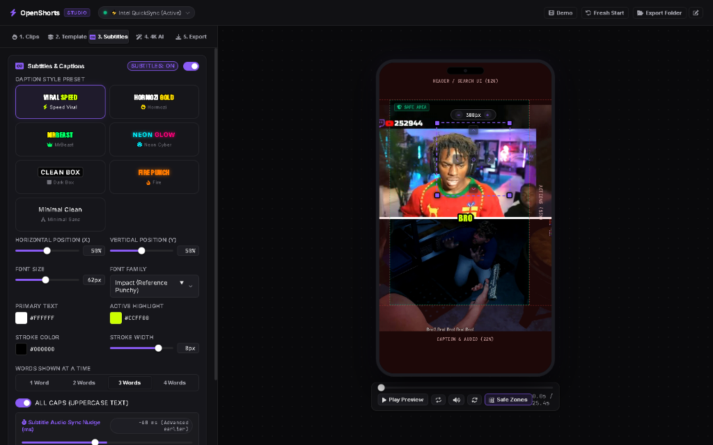
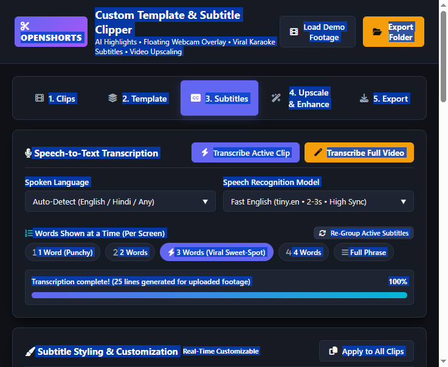
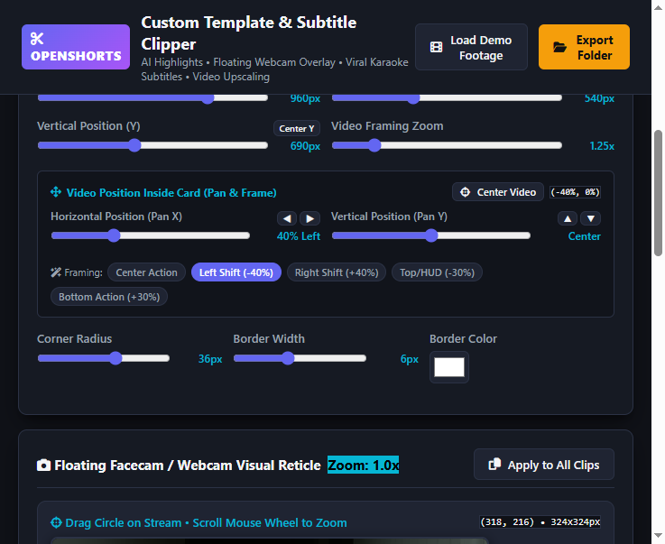

# OpenShorts Studio Pro

[](LICENSE)
[](https://www.python.org/downloads/)
[](https://fastapi.tiangolo.com)
[]()

**OpenShorts Studio** is an automated, hardware-adaptive AI clipping and formatting studio designed to turn multi-hour livestream footage and widescreen videos into viral, platform-optimized 9:16 vertical shorts (YouTube Shorts, Instagram Reels, TikTok).



---

## ⚡ Key Highlights & Core Capabilities

### 🧠 1. Story-First AI Clip Discovery & 2-Round Tournament
- **Acoustic & Heatmap Fusion**: Merges YouTube "Most Replayed" heatmaps with audio energy, pitch variance, and speech density peaks to identify the highest-excitement segments across multi-hour VODs.
- **2-Round `qwen3:8b` Story Tournament**: Evaluates candidate windows in a 2-round tournament to select the highest-retention moments and generate complete Ready-to-Post Kits (titles, descriptions, hashtags, pinned comments) with complete narrative arcs:
  - **Hook** (0–3s): Arresting statement or high-energy moment.
  - **Buildup**: Contextual dialogue and escalating tension.
  - **Payoff**: Satisfying punchline, climax, or gameplay conclusion.
- **Sentence-Locked Snapping**: Whisper speech alignment ensures cut boundaries snap cleanly to natural sentence pauses—never clipping dialogue mid-word.
- **Game-Agnostic Viral Titles**: Generates engaging, context-aware titles without clickbait distortion.

### 🎨 2. Zero-Blink DTW Karaoke Subtitles & Broadcast Audio Mastering
- **Millisecond DTW & Phoneme Alignment**: Direct acoustic word-level timestamps via `whisper.cpp` (`large-v3-turbo-q5_0` & `small.en`) with optional Wav2Vec2 phoneme forced alignment.
- **Zero-Blink Guarantee**: Strictly monotonic word intervals (`end >= start + 0.04s`) with gapless transitions inside phrases to prevent subtitle flickering.
- **Jitter-Free Multi-Word Karaoke**: Multi-word lines retain stable font scaling and centered positioning while highlighted words transition smoothly.
- **Viral Styling Presets**: Ready-to-use presets including **Studio Flow** (upright `Montserrat ExtraBold` with `FlowShadow` ambient lift, continuous 60fps subtle zoom, and 3-state word color transitions), **Speed Viral**, **Dark Box**, and **Minimal Sans**.
- **Broadcast Audio Mastering (`-14 LUFS`)**: Integrated dynamic compression and loudness normalization (`loudnorm=I=-14:TP=-2.0:LRA=11`) with 192 kbps AAC output for Shorts/Reels/TikTok punch.
- **Per-Screen Word Chunking**: Adjust display grouping on the fly (`1 Word`, `2 Words`, `3 Words Viral Sweet-Spot`, `4 Words`, `5 Words`, or `Full Phrase`).



### 🚀 3. Auto-Adaptive Hardware Speed Engine
- **Hardware Probing**: Automatically measures CPU cores, RAM, GPU vendor, discrete vs. integrated status, and VRAM capacity on startup across Windows, Linux, and macOS.
- **Dynamic Tiering**: Selects an optimal performance profile (`ultra`, `performance`, `balanced`, `eco`) to tune export concurrency, filter quality, Whisper thread count, and LLM context window (`llm_num_ctx`):
  - `ultra`: 16GB+ RAM, 8+ cores & 8GB+ dedicated VRAM (or Apple Silicon 24GB+) — multi-worker exports, `8192` LLM context, untiled Real-ESRGAN
  - `performance`: 4GB+ dedicated VRAM or 8+ cores / 16GB RAM — 2 workers, adaptive `4096`/`8192` LLM context, tiled Real-ESRGAN (`esrgan_tile`)
  - `balanced`: 6+ cores / 12GB RAM or iGPU — 1 worker, fast filters, `4096` LLM context
  - `eco`: <12GB RAM / low VRAM — memory-conserving sequential rendering, `4096` LLM context
- **Universal Hardware Encode & Decode**: Supports NVIDIA (`h264_nvenc` + `cuda` decode), Intel QuickSync (`h264_qsv` + `d3d11va`), AMD (`h264_amf` + `d3d11va`), Apple Silicon (`h264_videotoolbox`), and Linux (`h264_vaapi`), with automatic same-encoder no-hwdec retry and safe fallback to multi-threaded CPU `libx264`.
- **VRAM Handover & Tier-Gated Real-ESRGAN**: Automatically unloads idle Ollama LLM models before Whisper transcription or video rendering, and auto-downloads `realesrgan-ncnn-vulkan` on discrete GPU systems (`>= 4 GB VRAM`, prioritizing the discrete GPU on dual-GPU machines) while staying lightweight on integrated graphics.
- **Mask Caching**: Caches Pillow-generated corner masks and border PNGs in `assets/cache/` to eliminate duplicate image rendering during video composition.

### 🎬 4. Studio Pro NLE Workspace
- **Obsidian Dark Palette**: High-contrast, restrained dark design system built with clean typography (`Inter` & `JetBrains Mono`).
- **Draggable Split-Pane Resizer**: Smooth mouse-draggable divider between the left inspector controls and the 9:16 preview stage with double-click reset.
- **Continuous Gameplay Panning**: Adjust gameplay card size (`600px` to `1080px`) and pan X/Y positions inside the card to center HUD, crosshairs, or streamer cams.
- **Aspect Ratio Locking**: Lock gameplay to 16:9 widescreen or scale freely with Gaussian background bokeh.
- **Platform Safe-Zone Overlays**: Preview overlay guides for YouTube Shorts, Instagram Reels, and TikTok action margins.



### 🔒 5. Localhost-First Security & Mobile LAN Mode
- **Localhost Default**: Binds strictly to `http://127.0.0.1:8000` with restricted CORS origins (`localhost` / `127.0.0.1`) by default.
- **Path Traversal Defense**: All file-serving routes resolve strictly under authorized directories via canonical relative path verification.
- **Localhost-Gated Admin Operations**: Administrative operations (`/api/set_source`, `/api/set_export_folder`, `/api/factory_reset`, `/api/llm/pull`) are restricted to local clients.
- **Opt-In LAN Mode**: Pass `--lan` to `run.bat` (`run.bat --lan`) to bind to `0.0.0.0`, enabling multi-device preview and phone remote control across your local Wi-Fi.

---

## 🛠️ Prerequisites & Setup

### What Is Automatically Installed:
When you launch `run.bat`:
- An isolated Python virtual environment (`.venv`) is created automatically if Python is present.
- All Python dependencies from `requirements.txt` are verified and installed (including `fastapi`, `uvicorn`, `yt-dlp`, `pillow`, `aiofiles`, `pydantic`).
- Whisper GGML models (`ggml-large-v3-turbo-q5_0.bin` & `ggml-small.en.bin`) are downloaded on-demand when transcribing.

### System Requirements & External Binaries:
For the complete feature set, ensure the following are available on your system `PATH` or placed in `bin/`:
1. **FFmpeg & FFprobe**:
   - Install via winget: `winget install Gyan.FFmpeg`
   - Or place `ffmpeg.exe` and `ffprobe.exe` directly inside the `bin/` folder.
2. **Whisper.cpp (`whisper-cli`)**:
   - Bundled or placed inside `bin/Release/whisper-cli.exe` or available on your system `PATH`.
3. **Optional Local LLM (Ollama)**:
   - For offline AI story curation and viral moment scoring, install [Ollama](https://ollama.com) and pull `qwen3:8b`:
     ```bash
     ollama pull qwen3:8b
     ```
   - *Note*: If Ollama is offline or unavailable, OpenShorts automatically falls back to physical multimodal acoustic and visual scoring without interruption.

---

## 🚀 Quick Start Guide

### Launching the Studio:
1. Double-click `run.bat`:
   ```cmd
   run.bat
   ```
2. The Studio will initialize diagnostics and automatically open your default browser to:
   ```
   http://localhost:8000
   ```

### Enabling Mobile / Wi-Fi LAN Access:
To control the Studio or preview clips from a mobile device or secondary laptop on the same Wi-Fi network:
```cmd
run.bat --lan
```
The console will display your local IP access URL (e.g., `http://192.168.1.50:8000`).

---

## 📁 Repository Structure

```
OpenShorts-Studio/
├── backend/                  # FastAPI core backend
│   ├── main.py               # REST API endpoints & route handlers
│   ├── clipper.py            # Video probing, framing, filtergraph rendering
│   ├── hardware.py           # Auto-adaptive hardware detection & encoding
│   ├── viral_detector.py     # Multimodal acoustic, motion & LLM curation
│   ├── stream_loader.py      # yt-dlp livestream segment extractor & heatmaps
│   ├── transcriber.py        # whisper.cpp execution & DTW token alignment
│   ├── subtitle_generator.py # Zero-blink ASS/SRT karaoke subtitle engine
│   ├── llm_engine.py         # Ollama client & story-first prompt pipeline
│   ├── reset_data.py         # Factory reset & clean slate maintenance
│   └── bootstrap.py          # Pre-flight environment diagnostics
├── frontend/                 # Studio Pro Web Interface
│   ├── index.html            # 2-pane NLE layout & safe-zone preview stage
│   ├── styles.css            # Obsidian dark design system & CSS variables
│   └── app.js                # Interactive UI controls, draggable resizer, live preview
├── docs/                     # Documentation & user manuals
│   ├── USER_GUIDE.md         # Comprehensive user guide
│   └── images/               # Showcase screenshots and verification frames
├── tests/                    # Reusable verification test suite
│   ├── test_endpoints.py     # API endpoint health verification
│   ├── test_detect_endpoint.py # Viral detection API test
│   ├── test_viral.py         # Engine viral moment extraction test
│   ├── verify_export_and_modal.py # Full modal, gallery & static serving verification
│   └── verify_unified_brain.py # Multimodal + LLM pipeline verification
├── run.bat                   # 1-Click portable launcher for Windows
├── push_to_github.bat        # Portable git sync script
├── requirements.txt          # Python dependencies
└── .gitignore                # Clean runtime & media exclusion rules
```

---

## 🧪 Running Verification Tests

To verify that the Studio endpoints, gallery modal, and video serving are running smoothly:

```bash
# Ensure server is running on http://127.0.0.1:8000, then run:
python tests/verify_export_and_modal.py
python tests/test_endpoints.py
python tests/verify_unified_brain.py
```

---

## 📄 License

This project is licensed under the MIT License — see the [LICENSE](LICENSE) file for details.
