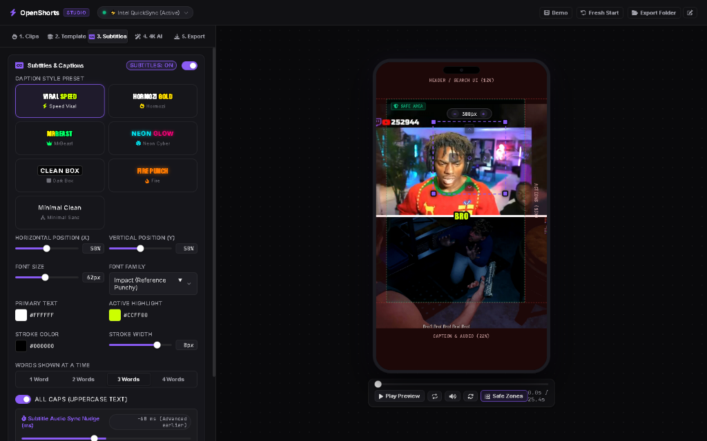
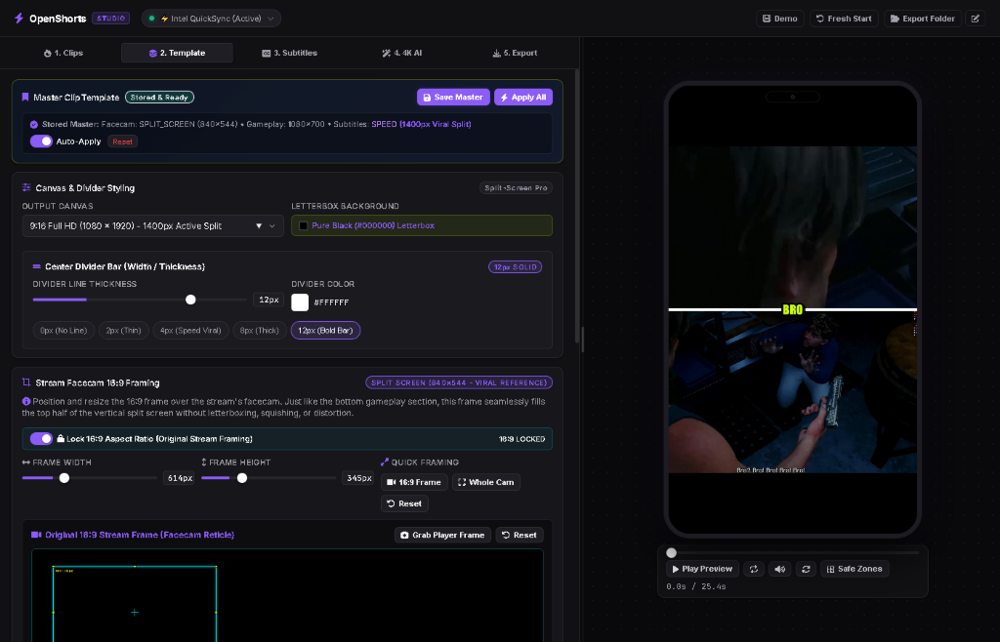
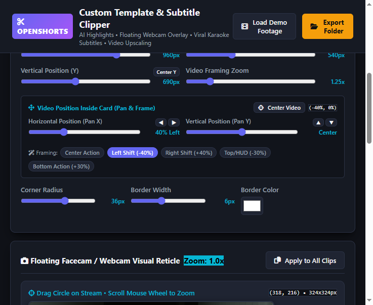
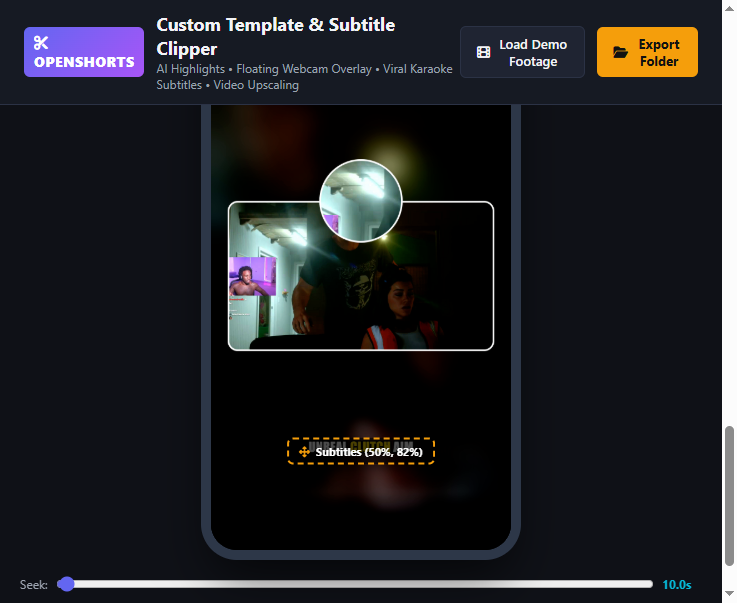
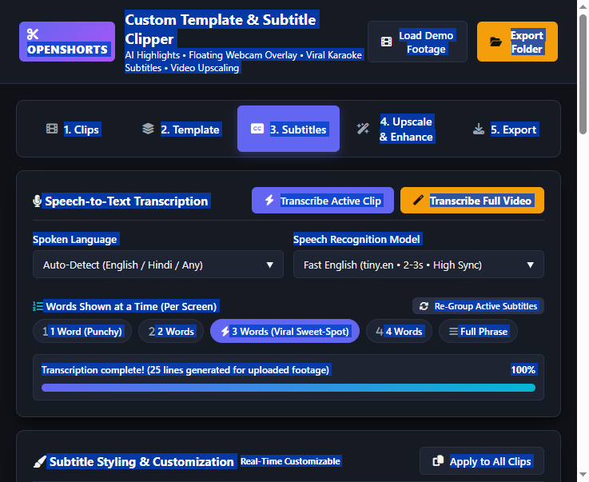
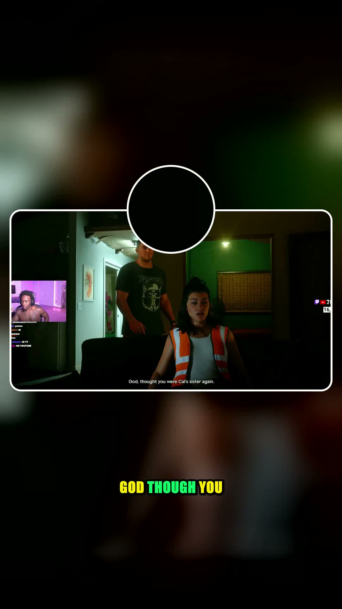
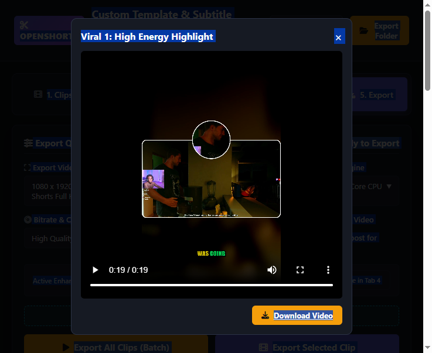

# OpenShorts Studio Pro: User Guide & Verified Pipeline

OpenShorts Studio is an automated, hardware-adaptive AI clipping studio that transforms long-form streams and widescreen videos into viral, platform-optimized 9:16 vertical shorts (YouTube Shorts, Instagram Reels, TikTok).

Running locally: **[http://localhost:8000](http://localhost:8000)** (or `http://127.0.0.1:8000`)

---

## Studio Interface Overview

OpenShorts Studio Pro features an obsidian dark-mode interface with a 2-pane Non-Linear Editor (NLE) layout:
- **Left Inspector Pane**: Complete controls for stream loading, AI viral detection, layout templating, subtitle styling, enhancer effects, and batch exporting.
- **Center Resizer**: Mouse-draggable divider to smoothly adjust the workspace width according to your display.
- **Right Preview Stage**: Live, high-fidelity 9:16 vertical canvas with realistic Shorts/Reels/TikTok safe-zone overlays.

---

## 1. Stream Loading & Story-First AI Clip Discovery

### Loading Footage:
1. **Local Video**: Drop any `.mp4`, `.mkv`, `.mov`, `.webm`, `.ts`, `.avi`, or `.m4v` into the studio.
2. **YouTube / Livestreams**: Paste any public video or livestream URL. OpenShorts uses `yt-dlp` to probe streams without downloading multi-gigabyte files up-front.

### AI Story-First Curation:
- **Heatmap & Chat Excitement**: Scans YouTube "Most Replayed" heatmaps and acoustic/pitch excitement peaks to pinpoint candidate moments.
- **Micro-Story Structuring**: Leverages `qwen3:8b` via Ollama to curate complete narrative arcs:
  - **Hook** (0–3s): An arresting opening statement or action.
  - **Buildup**: Contextual dialogue and rising tension.
  - **Payoff / Punchline**: Climax, punchline, or epic gameplay climax.
- **Sentence-Locked Snapping**: Automatically snaps cut boundaries to natural speech pauses so sentences are never clipped mid-word.

---

## 2. Dynamic 9:16 Templates & Facecam Framing

### Layout Modes:
- **Floating Facecam**: Seamless floating circular or rounded-rectangular facecam above centered widescreen gameplay.
- **Split-Screen (Top/Bottom)**: Classic streamer layout with 1:1 or 16:9 webcam on top and 16:9 gameplay on the bottom.

### Centered Gameplay Framing:
- **Continuous Card Dimensions**: Resize width (`600px` to `1080px`) and height (`350px` to `900px`).
- **Interactive Panning (Pan X / Pan Y)**: Shift video left, right, up, or down inside the frame to center crucial HUD, minimap, or gameplay action.
- **Aspect Ratio Lock**: Keep gameplay locked to true 16:9 widescreen or scale freely.
- **Background Bokeh**: Fast Gaussian-equivalent background blur (`0px` to `80px`) with adjustable dark vignette for subtitle contrast.

---

## 3. Zero-Blink DTW Subtitles & Animations

### Millisecond Dynamic Time Warping (DTW):
- Whisper acoustic neural alignment produces millisecond word start and end timestamps.
- Multi-word karaoke phrases maintain strict monotonic intervals (`end >= start + 0.04s`) with **zero blank gaps between words**, eliminating subtitle blinking.

### Viral Caption Presets:
- **Hormozi**: Crisp White (`#FFFFFF`) with Electric Gold (`#FFDE00`) word highlights and deep drop-shadow.
- **MrBeast**: Sunburst Yellow (`#FFE600`) with Neon Lime (`#00FF66`) highlight and heavy black border.
- **Neon Cyber**: Electric Cyan (`#00F5FF`) with Hot Magenta (`#FF007F`) karaoke glow.
- **Fire Red Alert**, **Box Pill**, **Clean Sky**, and **Minimal Modern**.

### "Words Shown at a Time" (Per-Screen Chunking):
- Choose between `1 Word (Punchy)`, `2 Words`, `3 Words (Viral Sweet-Spot)`, `4 Words`, or `Full Phrase`.
- Use the **Re-Group Active Subtitles** button to instantly re-chunk transcripts without re-running transcription.

---

## 4. Auto-Adaptive Hardware Acceleration

OpenShorts Studio automatically profiles your hardware on launch:
- **Hardware Encoders**: NVIDIA (`h264_nvenc`), Intel QuickSync (`h264_qsv`), AMD (`h264_amf`), Apple Silicon (`h264_videotoolbox`), Linux VA-API (`h264_vaapi`), or CPU (`libx264`).
- **Mask Caching**: Pillow-generated alpha masks and borders are cached in `assets/cache/` to eliminate redundant filtergraph computations.
- **Concurrency Scaling**: Automatically scales parallel render workers based on detected physical CPU cores and VRAM capacity.

---

## 5. Export Gallery & Video Modal

- **Interactive Gallery**: Exported clips are listed with duration, file size, timestamp, and cover thumbnails.
- **Instant Modal Player**: Click any clip in the gallery to preview it in a popup player with a direct download button.
- **Batch ZIP Download**: Export multiple clips simultaneously and download them in a single compressed ZIP archive.
